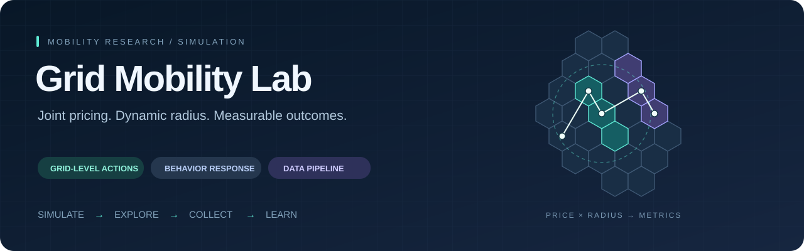

<div align="center">



# Grid Mobility Simulator

六网格网约车仿真与联合价格、匹配半径决策

</div>

项目用六边形网格模拟乘客发单、匹配、取消及司机响应，并记录六项运营指标。每个五分钟决策周期，为各网格选择价格乘子和匹配半径。

## 基线与数据

- [LSTM、TimesNet 与 DL-MRD](baseline/README.md)：预测冒泡请求数、订单呼出率、司机接单率、订单完成率、平均等待时间和平台收益。
- [DL-MRD 结构、训练与评估](baseline/dlmrd/README.md)
- [DL-MRD 训练曲线与闭环评估结果](results/dlmrd_joint_fusion_20261126/README.md)
- 数据管线入口：`run_data_pipeline.py`；实现位于 `data_pipeline/`。
- [数据说明](docs/data_guide.md) · [价格响应模型](docs/price_response_models.md)

训练权重和指标见 [checkpoints](checkpoints/README.md)。

## 运行

```bash
python3 -m pip install -r requirements.txt -r baseline/requirements.txt
python3 run_data_pipeline.py --help
```

仿真输入数据不包含在仓库中。运行真实仿真前，将订单、司机及路网数据放在 `my_data/grid6/`。

## 目录

```text
src/              仿真器、行为响应与网格决策
data_pipeline/    轨迹采集与监督数据处理
baseline/         LSTM、TimesNet、DL-MRD
checkpoints/      发布的模型权重
diagnostics/      仿真分析与科研绘图
tests/            测试
docs/             数据与模型说明
```

原始数据、训练缓存和逐次实验输出不纳入仓库。
